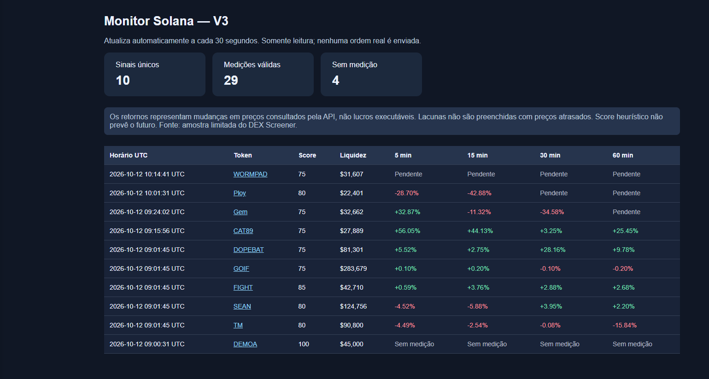
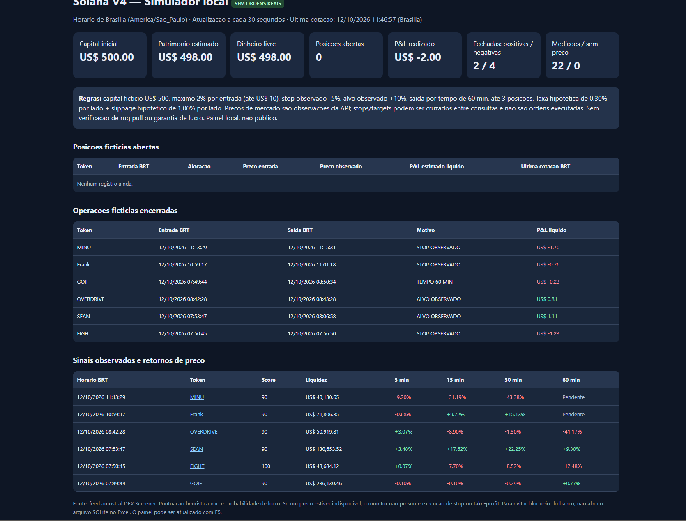
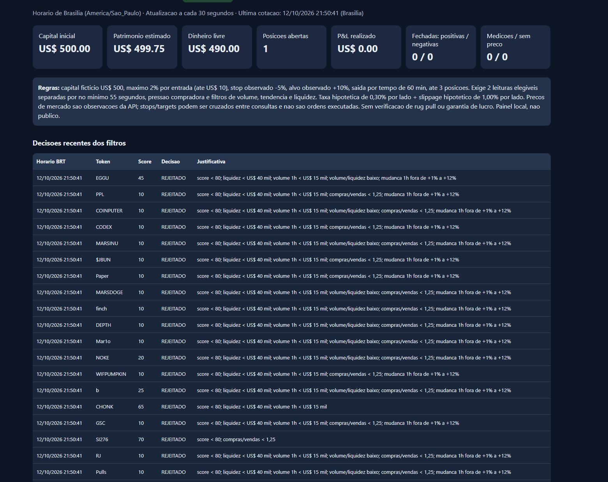
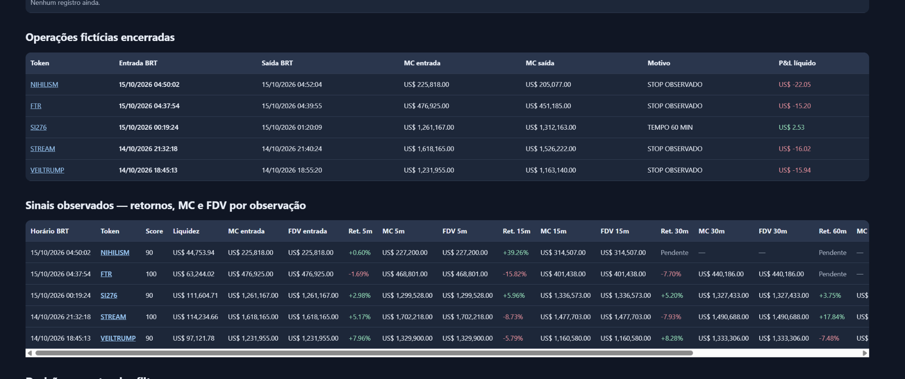
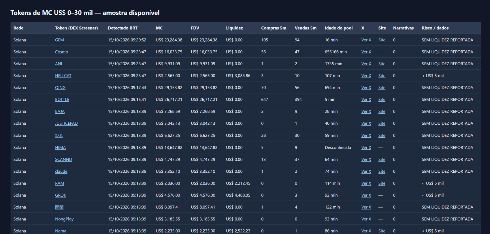
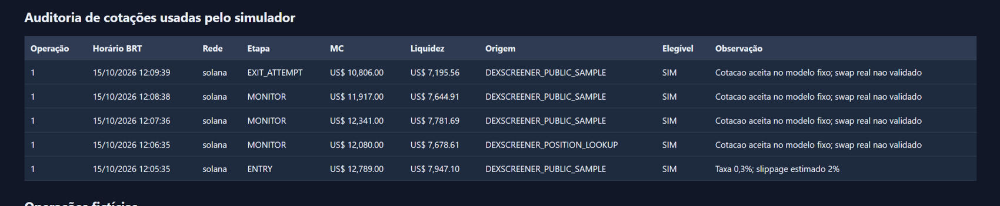
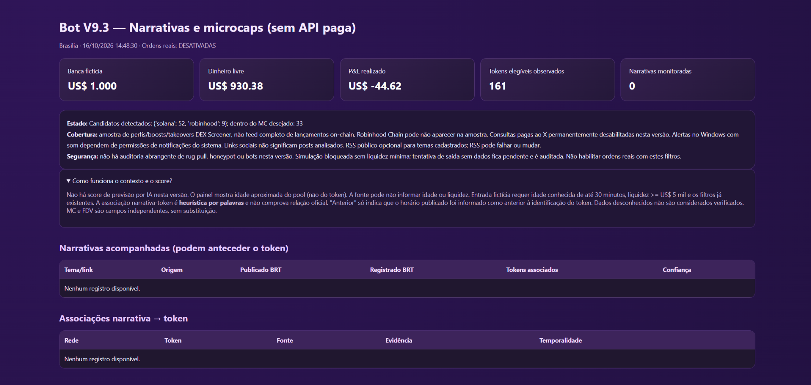
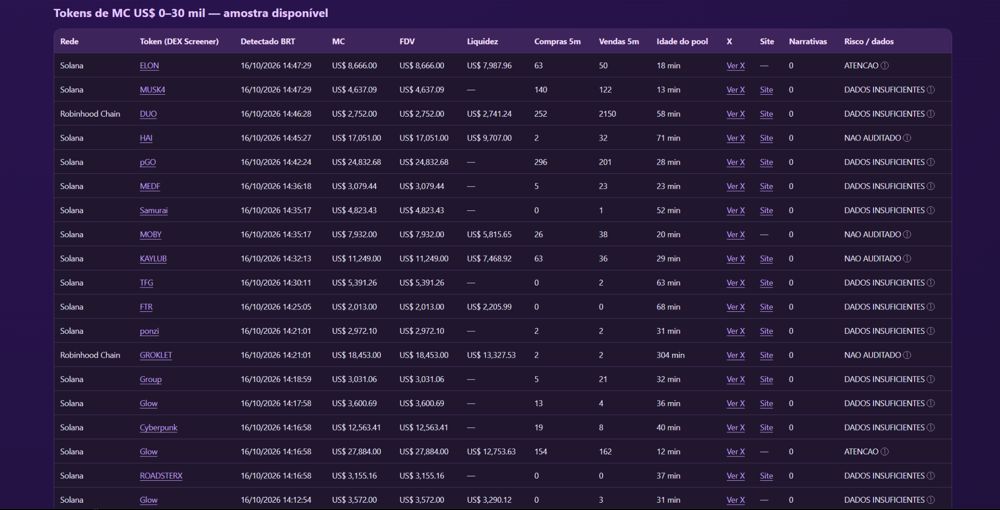
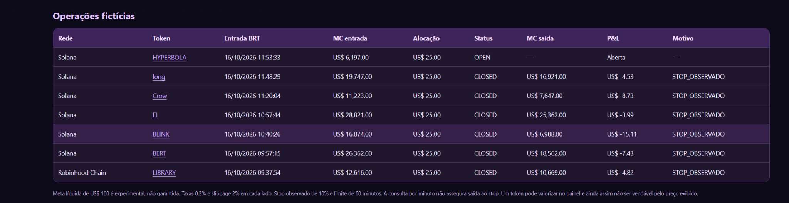

# Devlog — construindo um bot por conversa com IA

*Diário retrospectivo baseado na conversa e em prints enviados durante o desenvolvimento. Eu pedi, executei, colei erros e fui alterando o escopo. Não há commits históricos suficientes para atribuir datas precisas de escrita de cada trecho.*

## 01 — O scanner antes do trading

Eu parti de um post sobre Jev e AgenKit. Queria construir algo que monitorasse criptomoedas 24/7, mas comecei no meu PC, apenas observando dados do DEX Screener. Meu primeiro obstáculo foi até instalar Python. Cliquei no `.bat` e a janela fechou; trouxe o erro `No installed Python found`, instalei Python 3.13 com `winget` e voltei a testar.

## 02 — Logs, CSV e SQLite

Pedi medições após 5, 15, 30 e 60 minutos e um monitor persistente. Quando abri o CSV no Excel, o separador não foi interpretado como esperava. Em outra tentativa o arquivo ficou bloqueado e o CMD mostrou `Permission denied`: eu estava com o CSV aberto no Excel. Fechei e segui. Depois passamos a usar SQLite e painel HTML, reduzindo a dependência do CSV como fonte de estado.

## 03 — V4: paper trading antes do dinheiro

Eu defini capital fictício US$ 500, máximo 2% por posição, stop observado 5%, take-profit observado 10%, custos e slippage. Queria poder ver o patrimônio, posições abertas e fechadas e horários de Brasília. Na primeira amostra de seis operações, o resultado simulado era −US$ 2,00; isso me levou a questionar a qualidade do score.

## 04 — V5: não confiar em uma única leitura

Eu pedi filtros de volume, liquidez e pressão compradora, além de confirmação em duas leituras. O painel ganhou razões de rejeição. Houve sinais aprovados e rejeitados; o primeiro exemplo que acompanhei foi HUMPH, encerrado com +US$ 0,72 **fictícios**. Não tratei seis operações positivas posteriores como prova de vantagem estatística.

## 05 — V6: MC, FDV e migração de estado

Pedi MC na entrada e nas medições, links clicáveis e explicação do score. Depois percebi que MC e FDV precisavam aparecer separados. Um patch mudou o formato, mas primeiro não apareceu no painel; depois apareceu com tabelas vazias. Aprendi que substituir o código e manter o banco correto são operações separadas. Passei a indicar quando queria reaproveitar histórico ou começar com banco novo.

## 06 — V7–V8: meta experimental e risco

Na V7 passei para US$ 1.000 fictícios e alvo de US$ 100 líquidos por operação. Os resultados mostraram stops seguidos de recuperações tardias; discutimos trailing stop como hipótese, não como melhoria comprovada. Pedi auditoria de autoridade de emissão/congelamento, concentração de holders e indícios de bots na V8. Era importante separar *suspeita* de *fraude comprovada*.

## 07 — V9: microcaps e narrativa antes do token

Mudei a pergunta: em vez de encontrar tokens depois da alta, como localizar lançamentos na faixa de MC US$ 0–30 mil? Ampliei a descoberta experimental para Solana e Robinhood Chain. Pedi contexto de projetos, links do X, memes e notícias. No X Developer Console gerei um Bearer Token, mas o expus por engano em print; recebi a orientação de revogar/regenerar a credencial, mas a conclusão desse procedimento não ficou comprovada no registro. Depois a consulta retornou `HTTP 402: Payment Required`. Eu optei por **não comprar créditos**. A pesquisa paga foi desativada nas versões seguintes.

## 08 — V9.1: idade do pool e dados gratuitos

O painel passou a mostrar idade do pool, site e X quando disponíveis, além de RSS opcional. Vi pools com minutos de idade e outros muito antigos, mesmo todos tendo MC baixo. Também vi muita liquidez ausente ou zerada. As narrativas continuaram em zero na amostra analisada; dados do link social não são compreensão de posts.

## 09 — V9.2: auditar o que a simulação afirma

Um token (DacityCoin) apresentou +US$ 129,55 fictícios, mas a cotação de saída não constava no histórico regular. Isso não provava que o preço era inventado, mas impedia reconstituir a operação a partir da tabela de observações. Pedi que a versão seguinte gravasse cada cotação de execução com fonte, horário e liquidez, além de bloqueios por dados insuficientes. Na amostra de 19 operações encerradas, 2 foram positivas, 17 negativas, P&L total −US$ 20,82 **simulados**.

## 10 — V9.3: DX e alertas

Pedi painel roxo, nomes clicáveis nas operações, notificações locais com som, flags de risco e banco novo. Minha preocupação era que movimentos explosivos, como FTR na Robinhood Chain, parecessem bons apenas no P&L, sem auditoria adequada de liquidez e manipulação. O pacote V9.3 passou em testes offline relatados no histórico. **Depois, executei o painel no meu PC e compartilhei três capturas reais**, mostrando o tema roxo, a tabela de microcaps e as operações fictícias. Naquele registro havia 161 tokens observados, zero narrativas e P&L de −US$ 44,62 (simulado). **A exibição das notificações do Windows e o som continuam sem confirmação registrada.**

### A V9.3 realmente rodando — capturas que enviei

Não quis usar um mockup para mostrar a última versão. Quando percebi que o primeiro portfólio tinha imagens históricas como destaque, questionei se elas mostravam o painel que havíamos criado e enviei três prints verdadeiros da V9.3 já em execução.

**Painel e métricas:**

**Tokens observados:**

**Operações simuladas:**

Não são imagens geradas nem uma demonstração de operações reais. São registros de uma sessão em 16/10/2026. Ainda não tenho, nesta conversa, uma captura de um alerta do Windows com som confirmado.

## O que aprendi

Aprendi a pedir mudanças pequenas, apontar provas concretas (CMD, print, SQLite), preservar componentes úteis e diferenciar `roda sem erro` de `me dá um dado confiável`. Eu não documentei na conversa uma estratégia formal de economia de tokens: houve reaproveitamento de versões e patches, mas não um controle medido de custo de contexto. Em uma próxima iteração eu criaria testes regressivos e migrações desde a primeira versão, com commits identificando cada mudança.
