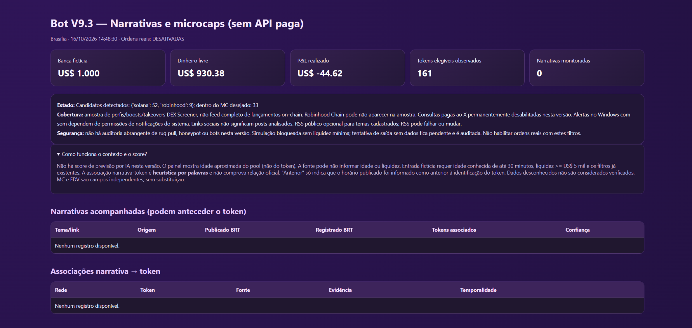
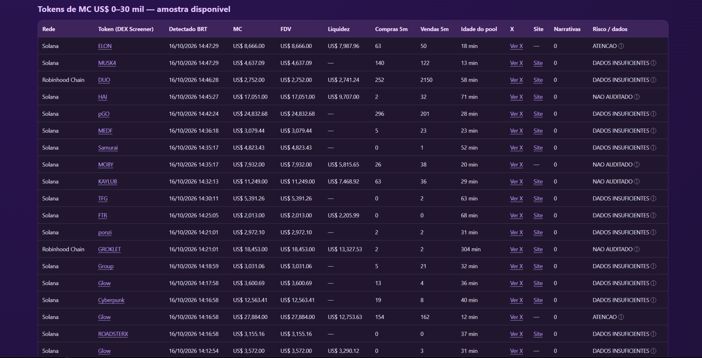
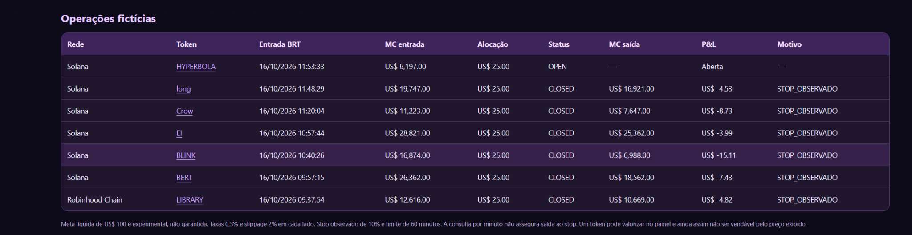
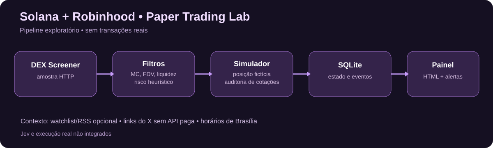

# Solana + Robinhood Chain — Vibecoding Trading Lab

> **Protótipo experimental de engenharia, não um serviço de investimento.** Scanner de microcaps e simulação de operações em Python, construído iterativamente por conversa com IA, testes no Windows, análise de SQLite e revisão de hipóteses. **Nenhuma ordem real é enviada.**



**Captura real da V9.3, obtida durante uma sessão em 16/10/2026, às 14:48 BRT.** Os valores exibidos são históricos e **fictícios**: banca de US$ 1.000, P&L realizado de **−US$ 44,62**, 161 tokens observados e **zero narrativas monitoradas** naquela sessão. Não é um mockup nem uma projeção de resultados; também não é a tela inicial com banco zerado.

## Por que fiz este projeto

Comecei explorando a ideia de combinar Jev/TypeSafe AI e AgenKit para decisões automatizadas. Em vez de integrar um modelo e arriscar capital de imediato, construí um scanner básico na Solana, medi sinais, acrescentei simulação de operações e fui mudando o projeto conforme encontrava problemas reais de coleta, persistência e auditoria. Mais tarde ampliei a descoberta experimental para pares classificados como **Solana e Robinhood Chain** nas fontes consultadas.

O foco da engenharia passou a ser: **como registrar decisões reproduzíveis com dados de mercado incompletos — sem confundir lucro simulado com execução possível?**

## O que a V9.3 efetivamente mostra

| Recurso | Situação documentada |
|---|---|
| Painel HTML com tema roxo | **Confirmado nos prints da V9.3 executada localmente** |
| Tokens com MC entre US$ 0 e US$ 30 mil; MC e FDV separados | **Visível no painel** |
| Nomes de tokens clicáveis nas operações fictícias | **Visível no painel**; destinos dependem dos links fornecidos pela fonte |
| P&L e posições fictícias, com motivo de encerramento | **Visível no painel**; não envolve operações reais |
| Auditoria de cotações e regras de liquidez | Presente no código; limitações na modelagem de swaps |
| Notificações locais e som no Windows | Implementadas no código; **entrega de toast e som não confirmada pelo print** |
| Flags de risco/dados | Aparecem na tabela; **não provam fraude ou segurança do token** |
| Motor de narrativas | Estrutura presente, porém **zero narrativas** na captura |
| API paga do X | Desativada |
| Jev / AgenKit | **Inspiração inicial; não integrados** |
| Backtest histórico independente | Não realizado/comprovado neste histórico |

### Capturas reais da versão atual

**Descoberta de microcaps:** pares, capitalização, FDV, liquidez, volume de transações de 5 minutos, idade aproximada do pool e alertas de dados.



**Operações simuladas:** token clicável, MC de entrada/saída, status, P&L e motivo. A captura inclui posição aberta e stops; os valores são resultados fictícios.



As três imagens são capturas fornecidas pelo desenvolvedor do painel rodando localmente, referentes a **um momento específico da sessão**, não a valores atuais, resultados reais ou à tela vazia da primeira execução. Veja também [origem e descrição das imagens](docs/IMAGENS.md).

## Arquitetura



- **Python 3.13:** chamadas HTTP periódicas e regras determinísticas de descoberta, entrada e saída simuladas.
- **DEX Screener:** amostra pública de pares/perfis, preços e metadados quando disponíveis; **não** é feed completo de novos lançamentos, nem garantia de preço executável.
- **SQLite:** tokens, observações, posições fictícias, cotações usadas, tentativas de saída e notificações.
- **HTML/CSS:** painel estático local atualizado pelo bot, com tema roxo na V9.3.
- **Windows:** scripts `.bat`, avisos e som dependentes da configuração do sistema.
- **Narrativas:** watchlist e RSS opcional, sem pesquisa paga no X; links sociais não significam que posts foram analisados por IA.

Não há integração WebSocket para execução de ordens nem assinatura de transações. A classificação da Robinhood Chain depende de `chainId` recebido da API, sem verificação independente abrangente.

## Evolução do protótipo

| Versão | Entrega principal |
|---|---|
| V1 | Scanner de Solana e score heurístico |
| V2–V3 | Medições em 5/15/30/60 minutos, SQLite e painel |
| V4 | Paper trading, banca US$ 500 fictícios, stop/alvo/custos |
| V5 | Filtros de liquidez e pressão compradora; confirmação em duas leituras |
| V6 | MC/FDV separados, evolução de capitalização, links e explicação de score |
| V7 | Nova simulação com US$ 1.000 fictícios; meta experimental de US$ 100/operação |
| V8 | Verificações experimentais de autoridade/concentração e sinais de risco |
| V9 | Solana + Robinhood Chain; foco em MC US$ 0–30 mil e contexto |
| V9.1 | Idade de pool, dados gratuitos, API paga do X desligada |
| V9.2 | Proveniência de cotações, tentativas de saída e bloqueios por liquidez |
| **V9.3** | **Painel roxo, nomes clicáveis, alertas locais, flags de risco e banco novo** |

O processo completo, incluindo erros de ambiente, correção de dados e decisões tomadas comigo e com a IA, está no [**DEVLOG**](DEVLOG.md).

## Como executar a V9.3 (Windows, apenas simulação)

Requisitos: Python 3.13, acesso à internet para dados públicos e `tzdata` quando necessário no Windows. Na raiz do projeto:

```bat
py -3.13 -m pip install tzdata
cd src\v9.3
TESTAR_V93.bat
INICIAR_V93.bat
```

Para abrir o painel local, execute `ABRIR_PAINEL_V93.bat` em outra janela. Interrompa o bot com `Ctrl+C`. O SQLite local é criado em `src/v9.3/dados/` e não deve ser publicado. O `TESTAR_V93.bat` testa o fluxo offline; **não comprova acesso a todas as fontes, segurança dos tokens ou rentabilidade**.

> **Importante:** o print da V9.3 comprova que o painel foi executado e recebeu dados nesta sessão. Não comprova que o alerta visual do Windows e o som funcionaram; isso deve ser demonstrado separadamente antes de ser anunciado como validado.

## Devlog, evidências e decisões

- [Devlog em primeira pessoa](DEVLOG.md)
- [Índice e origem das imagens](docs/IMAGENS.md)
- [Decisões de arquitetura](docs/DECISOES.md)
- [Experimentos simulados](docs/EXPERIMENTOS.md)
- [Limitações técnicas](docs/LIMITACOES.md)
- [Roadmap](docs/ROADMAP.md)
- [Segurança e privacidade](SECURITY.md)

## Estado atual e responsabilidades

**Laboratório experimental, não pronto para negociação com dinheiro real.** Liquidez reportada não é garantia de venda; stop observado pode executar muito abaixo do preço limite; os custos/slippage são aproximações. Heurísticas não substituem auditoria de contratos. Não há evidência de vantagem estatística ou estratégia vencedora.
